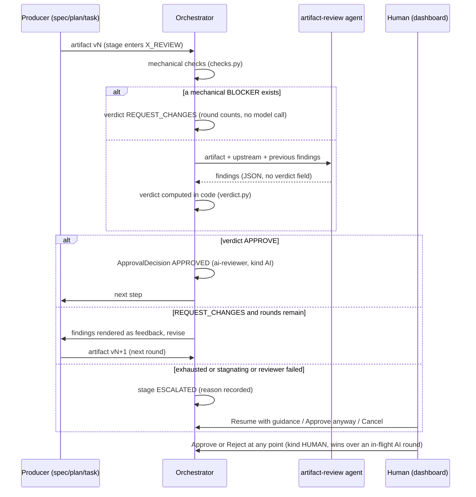

# AI review approval (Phase 12)

How the SPEC, PLAN, and TASK gates work when a project lets an AI
reviewer decide instead of a human. The producer agent writes the
artifact; the `artifact-review` agent reviews it; on `APPROVE` the run
advances, on `REQUEST_CHANGES` the findings go back to the *same*
producer, which revises and is reviewed again. The loop is bounded; a
run that does not converge escalates to a human. Human approval is
unchanged for projects that keep `mode: human`, and a human can
override an AI gate at any time.

Design invariants:

- The reviewer is a normal agent: single-shot `ModelGateway` caller,
  no side effects. The orchestrator stays the only sequencer — one
  dispatch per tick, honouring the `in_flight` token, crash-safe by
  the round key `(runId, stage, revision)`.
- The verdict is computed in code, never taken from the model. The
  model returns findings only; `APPROVE` holds iff no open finding has
  a severity in the resolved `blockOn` set.
- Mechanical (deterministic) checks run first; any mechanical BLOCKER
  short-circuits the round — the model is not called, but the round
  still counts.
- Every round is persisted as an `ARTIFACT_REVIEW` artifact plus
  events; every AI decision is recorded as an `ApprovalDecision` with
  reviewer `ai-reviewer` and `reviewer_kind` `AI`.

## Sequence

Escalation reasons (on the `APPROVAL_ESCALATED` event and the run's
waiting block): `MAX_REVISIONS` (round budget used up), `NO_PROGRESS`
(the set of open blocking finding ids did not shrink since the last
round), `REVIEWER_FAILED` (the reviewer errored twice in a row; a
reviewer failure is never converted into an approval), `BUDGET` (the
run-level round cap was hit). Exhaustion is evaluated before
stagnation, so a final round that also stagnates still reports
`MAX_REVISIONS`.

Finding identity across rounds: a new finding whose `(category,
normalized location)` matches an unlisted open finding of the previous
round is treated as that same finding (old id, `STILL_OPEN`) — a model
renumbering its findings neither inflates the blocking count nor hides
an unresolved blocker. If the previous round's review artifact is
unreadable, parsing stays lenient, a warning is logged, and an
`AI_REVIEW_DEGRADED` event (stage, round, reason) is emitted.

## Escalated gates: what a human can do

- **Resume with guidance** — the existing `ESCALATED --RESUME--> DRAFT`
  transition; an optional guidance comment (max 4000 chars) is
  delivered to the producer as feedback (a HUMAN `REQUEST_CHANGES`
  decision) and the loop restarts.
- **Approve anyway** — `POST /runs/{id}/escalation/approve` with a
  required reason; uses the additive workflow edge
  `ESCALATED --APPROVED--> APPROVED` (gated steps only; runs pinned to
  older workflow definitions are unaffected) and records an auditable
  HUMAN approval in one transaction.
- **Cancel** — the normal run cancel.

A human approve/reject on an AI-reviewing gate is also always
possible: in `ai` mode the gate's approval request lists reviewers
`["ai-reviewer"] + <profile human reviewers>` with `min_approvals 1`,
so the dashboard's Approve/Reject buttons work during `AI_REVIEWING`
and `ESCALATED`; the human decision is recorded with
`reviewer_kind HUMAN` and wins over any in-flight AI round (the loop
re-checks that the request is still `PENDING` before applying an AI
result).

## Configuration reference

Project profile, `configuration.approval`:

| Key | Values | Default | Meaning |
| --- | --- | --- | --- |
| `mode` | `ai` / `human` / `none` | from the workflow step | Who decides the SPEC/PLAN/TASK gates. |
| `perStage` | map of step id → the same keys | — | Per-stage overrides; highest precedence. |
| `maxRevisions` | integer 1..10 | 4 in `ai` mode, 3 in `human` | Producer revisions (review rounds) allowed per gate before escalation. |
| `onExhausted` | `escalate` / `accept_with_warnings` | `escalate` | What happens when `maxRevisions` is used up. `accept_with_warnings` approves with the open findings attached as warnings. |
| `blockOn` | list of `BLOCKER` / `MAJOR` / `MINOR` / `NIT` | `BLOCKER`, `MAJOR` | Severities that block approval. `BLOCKER` is always forced in. |
| `channel` | existing channel keys | — | Approval channel (dashboard / Teams), unchanged from Phase 8. |
| `notifyOnEscalation` | boolean | `false` | Teams channel only: send one informational message when a gate escalates (never per-round cards in `ai` mode). |

Resolution precedence per gate: `perStage` > profile > workflow step
> built-in. The shipped `software-development` workflow sets
`approval: {mode: ai, maxRevisions: 4}` on the spec, plan, and task
steps. The resolved block plus the run-level round cap are baked into
the run context at run start (`context["approval"]`), so editing a
profile does not change a running or resumed run — use Run again to
re-bake. Invalid Phase 12 keys fail run start loudly.

Platform configuration (`config/platform.yaml`):

| Key | Default | Meaning |
| --- | --- | --- |
| `agents.artifact-review.modelProfile` | `strong` | The reviewer runs on its own model profile, independent of the producer's. Set a per-agent model in the dashboard Settings to override. |
| run-level round cap | 12 | Total AI review rounds per run across all gates (`DEFAULT_MAX_REVIEW_ROUNDS`); hitting it escalates with reason `BUDGET`. |

Dashboard: project settings expose `mode`, `maxRevisions`, and
`onExhausted` with the same bounds as the server (1..10). The
Approvals page splits into **Needs human** (human-mode gates and
escalated runs) and **AI reviewed** (read-only round history);
`GET /runs/{id}/reviews` returns the per-stage rounds behind both.

Evaluation: `humanApprovalRate` counts human decisions only (null
when a project has none); AI gates report `aiReviewFirstPassRate`,
`aiReviewAvgRounds`, `aiReviewEscalationRate`, and
`aiReviewStagnationRate` in the overview's `aiReview` block.

## Troubleshooting

| Symptom | Likely cause | What to do |
| --- | --- | --- |
| Gate escalates with `NO_PROGRESS` after a few rounds | The producer edits the artifact but the same blockers stay open (or the findings are genuinely unfixable in one pass) | Read the round timeline (Approvals → AI reviewed, or the run page): if the producer is ignoring a finding, Resume with guidance naming it; if the finding is wrong, Approve anyway with a reason. |
| Reviewer too strict — MINOR/NIT findings block progress | `blockOn` widened beyond `BLOCKER`/`MAJOR`, or the checklist asks for more than the stage needs | Reset `blockOn` to the default; trim `instructions/checklist_<stage>.md` in the artifact-review package (it is on the agent's harness surface). |
| Reviewer too lenient — bad artifacts pass | The stage checklist is thin, or the reviewer model profile is too weak | Strengthen the checklist; point `agents.artifact-review.modelProfile` at a stronger profile. Mechanical checks only cover structure/traceability — judgement is the model's. |
| Cost: too many model calls per run | Every round is one reviewer call plus one producer revision call; `maxRevisions` 4 × 3 gates is the worst case of 12 rounds | Lower `maxRevisions` per project or per stage; put a cheaper model on the reviewer for early stages; watch `aiReviewAvgRounds` to see the real average. |
| Gate escalates with `REVIEWER_FAILED` | The reviewer model errored twice in a row (gateway, proxy, or an unparseable reply) | Check the backend log and the model settings (Settings → Test). The loop never approves on a reviewer failure; fix the model route, then Resume. |
| `AI_REVIEW_DEGRADED` events in the run history | A previous round's review artifact could not be parsed; matching fell back to a fresh round | Usually harmless after a backend upgrade mid-run. If it repeats every round, treat as `REVIEWER_FAILED` and check the stored artifacts. |
| Profile change has no effect on a resumed run | Approval settings are baked into the run at start | Start a fresh run (Run again) to pick up the new profile values. |
